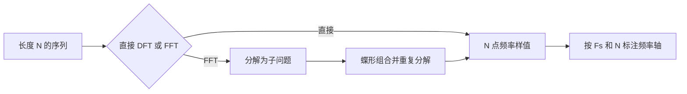

## 摘要

DFT 把有限长度序列映射为等间隔频率样点；FFT 是利用对称性和周期性高效计算 DFT 的算法族，并非另一种变换。掌握频率索引、循环卷积关系和补零边界，能避免频谱分析与快速卷积中的常见误读。

## 正文 / 要点

### DFT 定义与频率对应

对长度为 $N$ 的序列 $x[n]$，令 $W_N=e^{-j2\pi/N}$，则

$$
X[k]=\sum_{n=0}^{N-1}x[n]W_N^{nk},\quad k=0,\ldots,N-1
$$

$$
x[n]=\frac{1}{N}\sum_{k=0}^{N-1}X[k]W_N^{-nk}
$$

若采样率为 $F_s$，频率栅格为 $f_k=kF_s/N$（按双边频谱解释时，高于奈奎斯特频率的索引对应负频率）。DFT 假定输入按 $N$ 点周期延拓，因此频域相乘对应时域循环卷积。

### DFT 与 FFT 的区别

| 项目 | DFT | FFT |
| --- | --- | --- |
| 是什么 | 有限序列到有限频率样点的数学变换 | 计算 DFT 的高效算法 |
| 直接计算复杂度 | $O(N^2)$ | 基 2 FFT 约为 $O(N\log_2N)$ |
| 结果 | $N$ 个 DFT 系数 | 与同一约定下的 DFT 系数相同 |
| 使用提示 | 任意长度均有定义 | 基 2 蝶形算法通常要求 $N=2^m$；其他长度有混合基或其他算法 |

基 2 FFT 的复乘、复加次数随 $N\log_2N$ 增长；不同约定对旋转因子为 $1$ 或 $\pm j$ 的简化计数不同，比较运算量时应说明计数口径。

### 🧮 手算一个 4 点 DFT，并对应到 FFT

取 $x[0..3]=[1,0,-1,0]$，采用本文的负指数正变换约定。$W_4=e^{-j\pi/2}=-j$，偶数索引子序列为 $[1,-1]$，其 2 点 DFT 为 $E=[0,2]$；奇数索引子序列为 $[0,0]$，故 $O=[0,0]$。按基 2 蝶形合并

$$
X[k]=E[k\bmod2]+W_4^kO[k\bmod2]
$$

得到 $X=[0,2,0,2]$。这里奇支路为零，所以合并时只需复制偶支路结果；换用一般输入时，旋转因子会把奇支路的贡献按频点加减。用 IDFT 可核对原序列为 $[1,0,-1,0]$。频点 $k=1,3$ 分别对应 $F_s/4$ 与 $-F_s/4$，两个非零系数也符合实序列的共轭对称。

### 基 2 分解与顺序

按时间抽取（DIT）把输入分为偶、奇下标子序列；按频率抽取（DIF）则分解输出频率。两类算法都使用蝶形运算，运算量同阶。典型原位基 2 实现中，DIT 常见输入倒位序、输出自然序；DIF 常见输入自然序、输出倒位序。具体顺序取决于实现版本，使用库函数时以其文档为准。

### 频谱分析中的窗与补零

- 有限时长截取相当于时域乘窗；窗的频谱与信号频谱卷积，造成主瓣展宽和旁瓣泄漏。窗型需要在主瓣宽度、旁瓣高度及计算要求之间取舍。
- 增加真实观测时长通常能改善区分邻近频率的能力；单纯补零不会增加观测信息，也不会改善真实频率分辨能力。
- 将有限数据补零到更长的 FFT 点数，会在同一 DTFT 上取得更密的频率采样，使频谱曲线看起来更平滑，便于峰值定位。
- 频率栅格间隔为 $\Delta f=F_s/N_{\mathrm{FFT}}$；它不是两条谱线可被分辨的充分判据。

### 用 FFT 计算线性卷积

长度分别为 $N_x$ 和 $N_h$ 的有限序列做线性卷积，结果长度为 $N_x+N_h-1$。计算前把两者补零到 $L\ge N_x+N_h-1$，再做 $L$ 点 DFT 域相乘和 IDFT，才能避免循环卷积折叠。

## 相关笔记

- [[2026-11-05-离散序列与LTI系统基础]]
- [[2026-11-05-有限冲激响应滤波器设计]]
- [[2026-11-05-数字信号处理主题索引]]
- [[2026-11-05-信号与系统主题索引]]

本篇关注有限数据的频率采样和快速计算；变换定义之间的关系见 [[2026-11-05-离散傅里叶变换与FFT、拉普拉斯和Z变换的关系]]，卷积所需的补零理由也可回看该笔记中的循环卷积说明。

## 待办 / 延伸问题

- 用小长度序列手算 DFT，再核对 FFT 输出及所用正负号约定。
- 用两个有限序列比较未补零与满足长度条件补零后的 FFT 卷积。
