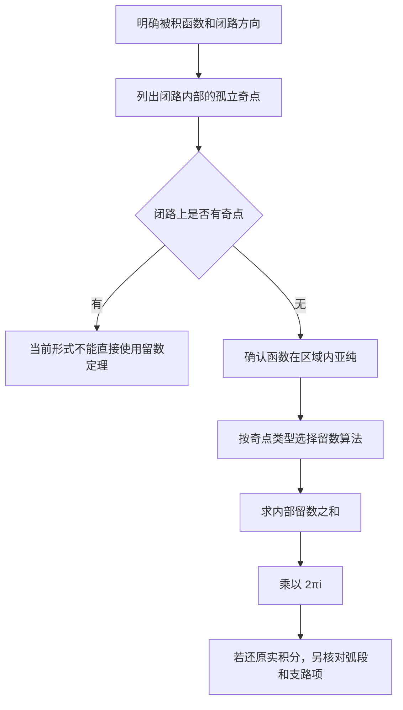

## 摘要

Taylor 级数描述解析点附近的函数，Laurent 级数适用于环域并显式包含负次幂。Laurent 主部可用于分类孤立奇点、计算留数；留数定理则把满足条件的闭路积分化为内部留数之和。

## 正文 / 要点

### Taylor 与 Laurent 级数

若 $f$ 在以 $z_0$ 为中心的圆盘内解析，则在该圆盘中

$$
f(z)=\sum_{n=0}^{\infty}\frac{f^{(n)}(z_0)}{n!}(z-z_0)^n.
$$

级数在以 $z_0$ 为中心、包含于解析域的最大圆盘内收敛；收敛半径由最近奇点或解析性边界决定。

若 $f$ 在环域 $r<|z-z_0|<R$ 内解析，则有唯一 Laurent 展开

$$
f(z)=\sum_{n=-\infty}^{\infty}a_n(z-z_0)^n.
$$

展开依赖所在环域；负次幂部分称主部。不同环域中的展开可以不同，不能把一个环域上的表达式不加检查地延伸到另一个环域。

### 🧪 例题：同一函数在不同环域有不同展开

考虑 $f(z)=1/[z(z-1)]$，以 $0$ 为中心展开。因奇点位于 $z=0,1$，可能的环域被 $|z|=1$ 分开。

在 $0<|z|<1$ 内，部分分式给出

$$
f(z)=-\frac{1}{z}-\frac{1}{1-z}
=-\frac{1}{z}-\sum_{n=0}^{\infty}z^n.
$$

在 $|z|>1$ 内，则改写为

$$
f(z)=\frac{z^{-2}}{1-z^{-1}}
=\sum_{n=0}^{\infty}z^{-(n+2)}.
$$

两式都来自几何级数，但分别要求 $|z|<1$ 与 $|z|>1$。选择展开式的第一步不是机械套公式，而是先确定目标点所在的环域；该环域也决定 Laurent 系数和后续留数计算所依据的级数。

### 孤立奇点分类

若 $f$ 在 $0<|z-z_0|<\varepsilon$ 内解析，则 $z_0$ 是孤立奇点。按 Laurent 主部分类：

| 奇点类型 | Laurent 主部 | 常用判据 | 例子 |
| --- | --- | --- | --- |
| 可去奇点 | 无负次幂 | $f$ 在去心邻域有界 | $\sin z/z$ 在 $z=0$ |
| $m$ 阶极点 | 只有有限个负次幂，最低次为 $(z-z_0)^{-m}$ | $(z-z_0)^m f(z)$ 在 $z_0$ 有非零有限极限 | $1/(z-z_0)^m$ |
| 本性奇点 | 有无穷多个负次幂 | 不属于前两类 | $e^{1/z}$ 在 $z=0$ |

### 留数与闭路积分

留数 $\operatorname{Res}(f,z_0)$ 是 Laurent 展开中 $(z-z_0)^{-1}$ 项的系数。简单极点可用

$$
\operatorname{Res}(f,z_0)=\lim_{z\to z_0}(z-z_0)f(z).
$$

若 $z_0$ 是 $m$ 阶极点，则

$$
\operatorname{Res}(f,z_0)=\frac{1}{(m-1)!}\lim_{z\to z_0}\frac{d^{m-1}}{dz^{m-1}}\left[(z-z_0)^m f(z)\right].
$$

若 $f$ 在包含正向简单闭曲线 $C$ 及其内部的区域内亚纯，且 $C$ 上没有奇点，则留数定理给出

$$
\oint_C f(z)\,dz=2\pi i\sum_{z_k\ \mathrm{inside}\ C}\operatorname{Res}(f,z_k).
$$

### 计算流程

> [!warning] 实积分的额外条件
> 留数定理给出闭路积分。用它求实积分时，还要证明辅助路径上的弧段积分趋于零，并正确处理分支、极点绕行和实轴上的奇点；这些不能仅凭“求了留数”省略。

### 原始资料

- [[2026-11-05-复变函数与积分变换-考点汇总]]
- [[2026-11-05-复变函数与积分变换小结]]
- [[2026-11-05-复变函数与积分变换（总结）]]

## 相关笔记

- [[2026-11-05-复数与解析函数]]
- [[2026-11-05-复变函数积分与柯西公式]]
- [[2026-11-05-复变函数主题索引]]

先用 [[2026-11-05-复数与解析函数]] 判断解析区域，再按本篇的 Laurent 主部定位奇点并求留数；闭路积分使用留数定理前，可与 [[2026-11-05-复变函数积分与柯西公式]] 对照其条件。

## 待办 / 延伸问题

- 用同一个有理函数分别在不同环域内求 Laurent 展开，观察展开形式和收敛域如何变化。
- 练习根据部分分式、极限和高阶极点公式选择最省步骤的留数算法。
