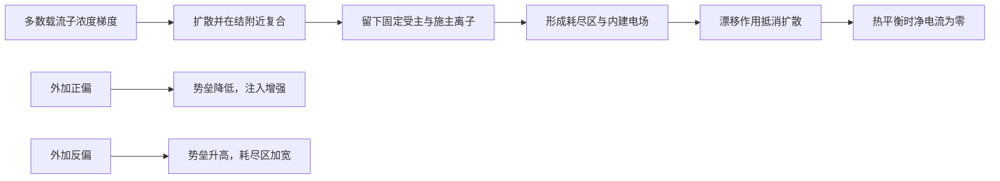

## 摘要

PN 结由 P 型和 N 型区域接触形成。多数载流子扩散留下固定离子，形成耗尽区和内建电场；外加正偏或反偏会改变势垒和载流子输运。

## 正文 / 要点

- 结形成初期，N 区电子向 P 区扩散、P 区空穴向 N 区扩散并复合，结附近留下带电的施主和受主离子。
- 固定离子形成空间电荷区/耗尽区，内建电场阻碍进一步扩散；热平衡时漂移电流与扩散电流相抵，净电流为零。
- 正向偏置降低势垒并缩窄耗尽区，促进载流子注入；反向偏置升高势垒并扩大耗尽区，少子漂移形成较小的反向电流。
- 反向电压继续增大可能进入齐纳或雪崩击穿。击穿是否可安全工作取决于器件设计、限流和功耗，不能把击穿电压简单当作长期工作电压。
- 二极管是 PN 结的器件化形式；其 I–V 曲线、结电容、扩散电容和反向恢复共同决定低频、高频和瞬态行为。

### 偏置状态对照

| 状态 | 外加偏置 | 势垒变化 | 耗尽区变化 | 主要载流子行为 |
|---|---|---|---|---|
| 热平衡 | 无外加偏置 | 保持内建势垒 | 保持平衡宽度 | 漂移与扩散电流抵消，净电流为零 |
| 正向偏置 | P 端接正、N 端接负 | 降低 | 变窄 | 多数载流子注入并形成较大的正向电流 |
| 反向偏置 | P 端接负、N 端接正 | 升高 | 变宽 | 少数载流子被电场扫过，击穿前反向电流较小 |

表中描述为一维 PN 结的定性趋势；实际器件还受掺杂分布、温度和几何结构影响。

图中的“耗尽”指自由载流子浓度显著降低，不是晶格中没有原子；离化杂质仍固定在原位并形成空间电荷。热平衡时电子和空穴仍在运动，只是漂移与扩散的净电流相抵。

### 关键定量关系

在均匀掺杂、非简并、突变结及耗尽近似下，内建电势为

$$
V_{\mathrm{bi}}=V_{\mathrm{T}}\ln\!\left(\frac{N_{\mathrm{A}}N_{\mathrm{D}}}{n_i^2}\right),\qquad V_{\mathrm{T}}=\frac{k_{\mathrm{B}}T}{q}.
$$

若外加电压 $V_{\mathrm{a}}$ 以正向为正，耗尽层总宽度近似为

$$
W=\sqrt{\frac{2\varepsilon_{\mathrm{s}}}{q}\left(\frac{1}{N_{\mathrm{A}}}+\frac{1}{N_{\mathrm{D}}}\right)(V_{\mathrm{bi}}-V_{\mathrm{a}})}.
$$

其中 $N_{\mathrm{A}}$、$N_{\mathrm{D}}$ 分别为受主和施主浓度，$n_i$ 为本征载流子浓度，$\varepsilon_{\mathrm{s}}$ 为半导体介电常数。理想低注入条件下，二极管电流近似满足 Shockley 方程 $I_{\mathrm{D}}=I_{\mathrm{S}}\left[\exp\!\left(\frac{V_{\mathrm{D}}}{nV_{\mathrm{T}}}\right)-1\right]$；其中 $I_{\mathrm{S}}$ 为反向饱和电流，$n$ 为理想因子，$V_{\mathrm{D}}$ 以正向偏置为正。高注入、串联电阻和击穿等效应会使实际曲线偏离该式。

### 用电荷守恒预判耗尽区位置

在突变结耗尽近似下，结两侧固定空间电荷大小相等：

$$
qN_{\mathrm{A}}x_{\mathrm{p}}=qN_{\mathrm{D}}x_{\mathrm{n}},\qquad
\frac{x_{\mathrm{p}}}{x_{\mathrm{n}}}=\frac{N_{\mathrm{D}}}{N_{\mathrm{A}}}.
$$

这里 $x_{\mathrm{p}}$ 和 $x_{\mathrm{n}}$ 分别是耗尽区伸入 P、N 区的宽度。若 $N_{\mathrm{A}}=10N_{\mathrm{D}}$，则 $x_{\mathrm{p}}=0.1x_{\mathrm{n}}$；较轻掺杂的 N 侧承担大部分耗尽宽度。这个比例可先帮助判断空间分布，再用总宽度公式求数值。上述结论依赖一维突变结和耗尽近似，不适用于任意渐变结或强反偏击穿状态。

本篇的耗尽层与结电流从载流子统计和输运出发：[[2026-11-05-半导体载流子与掺杂]] 说明平衡浓度，[[2026-11-05-半导体载流子输运与产生复合]] 说明漂移、扩散与复合；再往下可用 [[2026-11-05-二极管伏安特性与击穿]] 读实际 I–V 曲线。

## 相关笔记

- [[2026-11-05-半导体载流子与掺杂]]
- [[2026-11-05-二极管伏安特性与击穿]]
- [[2026-11-05-二极管等效模型]]
- [[2026-11-05-二极管直流工作点与等效分析]]
- [[2026-11-05-PN结与载流子动画讲解]]
- [[2026-11-05-二极管伏安特性击穿与稳压动画讲解]]

## 待办 / 延伸问题

- 画出平衡、正偏和反偏 PN 结的电荷、电场与势垒变化。
