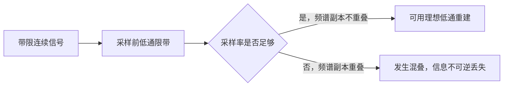

## 摘要

傅里叶分析把信号表示为不同频率复指数的组合：周期信号用离散谐波系数（傅里叶级数），非周期信号通常用连续频谱（傅里叶变换）。理想采样会在频域产生周期谱副本；采样率不足会使副本重叠，造成混叠。

## 正文 / 要点

### 📈 周期信号与非周期信号

| 表示 | 适用对象 | 正变换 | 频域形态 |
| --- | --- | --- | --- |
| 连续时间傅里叶级数 | 周期信号，基波角频率 $\omega_0=2\pi/T_0$ | $C_k=\frac{1}{T_0}\int_{t_0}^{t_0+T_0}x(t)e^{-jk\omega_0t}\,\mathrm{d}t$ | 只含基频整数倍 $k\omega_0$ 的离散谱线 |
| 连续时间傅里叶变换 | 非周期信号及满足广义条件的信号 | $X(j\omega)=\int_{-\infty}^{\infty}x(t)e^{-j\omega t}\,\mathrm{d}t$ | 通常为连续频谱；周期信号对应冲激谱线列 |

对分段连续、有限个极值且满足通常 Dirichlet 条件的周期信号，傅里叶级数在连续点收敛到 $x(t)$，在跳变点收敛到左右极限的平均值 $[x(t^-)+x(t^+)]/2$。傅里叶变换则要求积分绝对可积等充分条件，或在能量信号/广义函数意义下定义；“公式能写出”不自动保证普通积分收敛。

本笔记使用角频率 $\omega$（单位 rad/s）。若改用普通频率 $f$（单位 Hz），定义为 $X_f(f)=\int_{-\infty}^{\infty}x(t)e^{-j2\pi ft}\,\mathrm{d}t$，且 $X(j\omega)=X_f(\omega/(2\pi))$。使用不同约定时，$2\pi$ 因子会出现在不同位置，不能混用变换对。傅里叶变换在绝对可积等充分条件下由普通积分定义；对能量信号或周期信号，也可分别在平方可积或广义函数意义下处理。

直观上，复指数 $e^{jk\omega_0t}$ 是频率为 $k\omega_0$ 的“方向基底”。傅里叶系数像向量在一组正交方向上的投影：把信号乘上某个基底的共轭，再在一个周期内积分，会抵消其他整数谐波，只留下对应的第 $k$ 个分量。正交性表达为

$$
\frac{1}{T_0}\int_{t_0}^{t_0+T_0}e^{jm\omega_0t}e^{-jk\omega_0t}\,\mathrm{d}t
=\begin{cases}1,&m=k,\\0,&m\ne k.\end{cases}
$$

因此合成式中的 $C_k$ 正是分析式所提取的权重。非周期信号可看作周期趋于无穷大的极限；此时离散谐波间距趋近于零，离散系数转为连续频谱密度，这给出了傅里叶级数与傅里叶变换之间的直觉联系。

傅里叶级数的合成式为

$$
x(t)=\sum_{k=-\infty}^{\infty}C_k e^{jk\omega_0 t}.
$$

这里 $T_0$ 是一个周期，$\omega_0=2\pi/T_0$ 是基波角频率，$k$ 是任意整数谐波序号，$C_k$ 是该频率分量的复权重；$t_0$ 只是任选的积分起点，只要积分区间覆盖完整周期即可。

若 $x(t)$ 为实信号，可改写成三角形式

$$
x(t)=\frac{a_0}{2}+\sum_{k=1}^{\infty}\left[a_k\cos(k\omega_0t)+b_k\sin(k\omega_0t)\right],
$$

其中 $a_k=\frac{2}{T_0}\int_{t_0}^{t_0+T_0}x(t)\cos(k\omega_0t)\,\mathrm{d}t$，$b_k=\frac{2}{T_0}\int_{t_0}^{t_0+T_0}x(t)\sin(k\omega_0t)\,\mathrm{d}t$，$a_0=\frac{2}{T_0}\int_{t_0}^{t_0+T_0}x(t)\,\mathrm{d}t$。复系数与三角系数的关系为 $C_k=(a_k-jb_k)/2$、$C_{-k}=(a_k+jb_k)/2$（$k>0$），且 $C_0=a_0/2$。

周期信号的平均功率可由 Parseval 等式在时域或频域计算：

$$
P=\frac{1}{T_0}\int_{t_0}^{t_0+T_0}|x(t)|^2\,\mathrm{d}t
=\sum_{k=-\infty}^{\infty}|C_k|^2.
$$

采用上述变换约定时，逆变换为

$$
x(t)=\frac{1}{2\pi}\int_{-\infty}^{\infty}X(j\omega)e^{j\omega t}\,\mathrm{d}\omega.
$$

周期信号可由其傅里叶级数系数写成广义傅里叶变换：

$$
X(j\omega)=2\pi\sum_{k=-\infty}^{\infty}C_k\delta(\omega-k\omega_0).
$$

### 🧪 例题：矩形脉冲为何产生 sinc 频谱

设脉冲幅度为 $1$，宽度为 $T$，并以原点为中心：$x(t)=1$（$|t|<T/2$），其他位置为 $0$。按变换定义，只有脉冲非零区间需要积分：

$$
X(j\omega)=\int_{-T/2}^{T/2}e^{-j\omega t}\,\mathrm{d}t
=\left.\frac{e^{-j\omega t}}{-j\omega}\right|_{-T/2}^{T/2}
=\frac{2\sin(\omega T/2)}{\omega}
=T\,\operatorname{sinc}\!\left(\frac{\omega T}{2\pi}\right).
$$

在 $\omega=0$ 处取极限得到 $X(0)=T$，恰好等于脉冲面积。第一个零点满足 $|\omega|=2\pi/T$，所以脉冲越窄，频谱主瓣越宽；这是时间局部化与频率扩展之间的定量联系。这里使用 $\operatorname{sinc}(u)=\sin(\pi u)/(\pi u)$。

### 🔁 傅里叶变换常用性质

以下采用 $X(j\omega)=\int x(t)e^{-j\omega t}\,\mathrm{d}t$ 的角频率约定；各性质需满足相应积分或广义函数条件。

| 时域操作 | 频域关系 | 说明 |
|---|---|---|
| $a x_1(t)+b x_2(t)$ | $aX_1(j\omega)+bX_2(j\omega)$ | 线性 |
| $x(t-t_0)$ | $e^{-j\omega t_0}X(j\omega)$ | 延时引入线性相位 |
| $e^{j\omega_0t}x(t)$ | $X(j(\omega-\omega_0))$ | 调制对应频谱平移 |
| $x(at)$，$a\ne0$ | $\frac{1}{\lvert a\rvert}X(j\omega/a)$ | 时间压缩会扩展频谱 |
| $\frac{\mathrm{d}x}{\mathrm{d}t}$ | $j\omega X(j\omega)$ | 边界项消失或按广义函数解释时 |
| $t x(t)$ | $j\frac{\mathrm{d}X}{\mathrm{d}\omega}$ | 需变换可微等条件 |
| $x(t)*h(t)$ | $X(j\omega)H(j\omega)$ | 时域卷积定理 |
| $x(t)h(t)$ | $\frac{1}{2\pi}(X*H)(j\omega)$ | 频域卷积含 $1/(2\pi)$ 系数 |

对于有限能量信号，Parseval 等式为

$$
\int_{-\infty}^{\infty}|x(t)|^2\,\mathrm{d}t
=\frac{1}{2\pi}\int_{-\infty}^{\infty}|X(j\omega)|^2\,\mathrm{d}\omega.
$$

常见变换对（单位阶跃 $u(t)$，频率变量为角频率）：

| $x(t)$ | $X(j\omega)$ | 条件或说明 |
|---|---|---|
| $\delta(t)$ | $1$ | 冲激抽样的单位面积约定 |
| $1$ | $2\pi\delta(\omega)$ | 广义函数意义 |
| $e^{-at}u(t)$ | $\frac{1}{a+j\omega}$ | $a>0$ |
| $e^{-a\lvert t\rvert}$ | $\frac{2a}{a^2+\omega^2}$ | $a>0$ |
| $x(t)=1$（$-T/2<t<T/2$，其余为 0） | $T\,\operatorname{sinc}(\omega T/(2\pi))$ | $\operatorname{sinc}(u)=\sin(\pi u)/(\pi u)$ |

实信号满足共轭对称 $X(-j\omega)=X^*(j\omega)$；实偶信号的变换为实偶函数，实奇信号的变换为纯虚奇函数。该对称性可用于检查变换计算和单边幅度谱。

频谱不仅有幅度，也有相位。对 LTI 系统，在变换及卷积定理适用时，时域卷积转成频域相乘：

$$
y_{zs}(t)=x(t)*h(t)\quad\Longleftrightarrow\quad Y(j\omega)=X(j\omega)H(j\omega).
$$

### 🎚️ 理想采样与混叠

设采样周期 $T_s$、采样角频率 $\omega_s=2\pi/T_s$。理想冲激采样为

$$
x_s(t)=\sum_{n=-\infty}^{\infty}x(nT_s)\delta(t-nT_s),\qquad
X_s(j\omega)=\frac{1}{T_s}\sum_{k=-\infty}^{\infty}X\bigl(j(\omega-k\omega_s)\bigr).
$$

这表示原频谱以 $\omega_s$ 为间隔重复。若原信号严格带限于最高频率 $f_m$，为避免频谱副本在边界接触，通常要求 $f_s>2f_m$，并在采样前使用抗混叠低通滤波器；$f_s=2f_m$ 是理想临界情形，需满足谱边界可恢复等附加假设。

在理想带限且采样率严格高于奈奎斯特率时，可用 sinc 插值恢复连续信号；临界采样还需满足谱边界可恢复等附加假设：

$$
x(t)=\sum_{n=-\infty}^{\infty}x(nT_s)\,\operatorname{sinc}\!\left(\frac{t-nT_s}{T_s}\right),\qquad
\operatorname{sinc}(u)=\frac{\sin(\pi u)}{\pi u}.
$$

### ⚠️ 使用边界

- 傅里叶变换通常用于能量有限或满足更一般收敛条件的信号。周期信号的能量往往无限，但可用冲激谱线的广义意义表示。
- 采样定理依赖严格带限和理想重建假设；真实信号通常不是严格带限，采样系统也非理想。
- $f_s=2f_m$ 是理想理论边界；若边界频率上存在谱线，需检查采样相位和频谱边界条件是否仍可唯一恢复。实际采样宜高于该值，并给滤波器过渡带留空间。

## 相关笔记

- [[2026-11-05-信号分类与基本运算]]
- [[2026-11-05-离散傅里叶变换与FFT、拉普拉斯和Z变换的关系]]
- [[2026-11-05-拉普拉斯变换与连续系统分析]]
- [[2026-11-05-信号与系统主题索引]]

傅里叶级数与变换描述频率成分；拉普拉斯变换在此基础上加入指数增长/衰减权重。采样则把连续信号转为离散序列，后续可沿 [[2026-11-05-离散傅里叶变换与FFT、拉普拉斯和Z变换的关系]] 继续理解 DTFT、DFT 与 FFT。

## 待办 / 延伸问题

- 用矩形脉冲计算傅里叶变换，观察脉冲宽度与主瓣宽度的反比关系。
- 绘制一个带限频谱在采样前后的重复副本，分别比较 $f_s>2f_m$ 与 $f_s<2f_m$。
