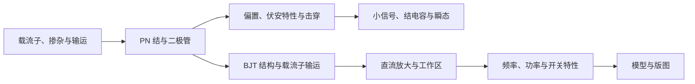

---
title: "半导体器件物理分类知识点总结"
type: raw
source: "未提供（个人整理文档）"
author: "未知"
created: 2026-11-05
tags:
  - "主题/半导体器件"
  - "类型/原始资料"
  - "状态/已归档"
status: archived
---

> 根据《半导体器件物理》课件（第1—6章）与 Neamen《半导体物理与器件》（第四版）整理。课件主线是 PN 结、双极型晶体管（BJT）的直流放大、频率特性、功率特性、开关特性及模型/版图；教材中半导体平衡与非平衡载流子、PN 结/二极管及双极晶体管相关内容用于补充物理基础。
>
> 约定：PN 结外加电压 `V_a` 以 P 端接正、N 端接负为正向；`V_a > 0` 为正偏，`V_a < 0` 为反偏。不同教材的电流正方向可能不同，使用公式时要先核对符号约定。

### 知识路线

这张路线图展示章节间的概念依赖，不代替后文公式、模型条件和器件边界。

## 一、基础知识：先建立器件图像

### 1. 半导体与载流子

- **本征半导体**：未掺杂或杂质影响可忽略的半导体，电子浓度与空穴浓度相等，记为本征载流子浓度 `n_i`。
- **N 型半导体**：掺入施主杂质，电子为多数载流子，空穴为少数载流子；施主浓度记为 `N_D`。
- **P 型半导体**：掺入受主杂质，空穴为多数载流子，电子为少数载流子；受主浓度记为 `N_A`。
- 热平衡时满足**质量作用定律**：`n_0 p_0 = n_i^2`。若完全电离且非简并，N 型中通常 `n_0 ≈ N_D`、`p_0 ≈ n_i²/N_D`；P 型中通常 `p_0 ≈ N_A`、`n_0 ≈ n_i²/N_A`。
- 载流子运动有两种基本机制：
  - **漂移**：电场驱动载流子运动。
  - **扩散**：载流子由高浓度区域向低浓度区域运动。
- **爱因斯坦关系**：`D/μ = kT/q = V_T`，把扩散系数 `D` 与迁移率 `μ` 联系起来。

### 2. PN 结的形成与偏置

- P 区与 N 区交界形成 PN 结，交界面称为**冶金结**。掺杂分布均匀的理想化结构常称**突变结**；掺杂随位置变化的结称**缓变结**。
- 结形成后，多数载流子先因浓度差发生扩散，在结附近留下不能移动的离化受主/施主离子，形成**耗尽区**（也称空间电荷区、势垒区）。耗尽区内有内建电场和内建电势。
- 达到热平衡时，扩散电流与漂移电流相互抵消，净电流为零，整个结具有统一的费米能级。
- **正向偏置**降低势垒、缩窄耗尽区，促进多数载流子注入；**反向偏置**升高势垒、扩大耗尽区，常规反向电流较小。
- 一侧掺杂远高于另一侧时称为**单边结**。耗尽区主要伸入掺杂较轻的一侧。

### 3. PN 结二极管

- 正偏时，P 区空穴注入 N 区、N 区电子注入 P 区，成为对方区域的少数载流子；它们扩散并复合，形成正向电流。
- 反偏时，少子被电场扫过耗尽区，形成小的反向电流；达到击穿条件后，反向电流会迅速增大。
- 二极管的小信号行为取决于直流偏置点附近的斜率；大信号开关行为还受器件内部存储的少数载流子电荷影响。

### 4. BJT 双极型晶体管

- **BJT**（Bipolar Junction Transistor，双极型晶体管）由两个背靠背的 PN 结构成，有发射区 E、基区 B、集电区 C 三个区域和三个端子。
- **NPN** 与 **PNP** 的掺杂顺序和载流子/电流方向相反。以 NPN 为例，正向放大时 BE 结正偏、BC 结反偏；发射区向薄基区注入大量电子，少部分在基区复合形成基极电流，大部分到达集电结后被电场收集，形成集电极电流。
- 三个常见工作区：
  - **截止**：BE 结未充分正偏，器件近似关断。
  - **正向放大（有源）**：BE 正偏、BC 反偏，集电流主要由 BE 偏压控制。
  - **饱和**：BE 与 BC 结都正偏，器件充分导通，但存储电荷较多，关断会变慢。

## 二、重要知识：按课件章节抓主线

### 第1章：PN 结

1. **平衡 PN 结**：掌握载流子扩散、离化杂质、电场方向、势垒、电荷中性与耗尽层宽度之间的联系。
2. **理想直流伏安特性**：理想二极管电流随正向电压近似指数增加；反偏时电流约为反向饱和电流，击穿前对电压变化不敏感。
3. **实际 I–V 偏离**：耗尽区复合/产生、表面漏电、高注入、串联电阻和温度都会使实际曲线偏离理想模型。低正向电流时耗尽区复合可能明显；中等正向电流时扩散电流更接近理想指数关系；大电流下串联电阻和高注入效应变重要。
4. **击穿**：齐纳击穿主要与强电场下的隧穿有关，常见于重掺杂、耗尽区较窄的结；雪崩击穿来自碰撞电离，常见于耗尽区较宽、载流子获得足够能量的结。
5. **交流小信号**：正向偏置附近的微分电导和扩散电容重要；反向偏置时势垒/耗尽层电容通常更重要。
6. **瞬态与模型**：导通转关断时，先要抽走或复合存储电荷，故会出现反向恢复；二极管等效模型常包含 I–V 电流源、扩散电容 `C_D`、结电容 `C_J` 与串联电阻 `R_S`。

### 第2章：BJT 直流放大特性

- 基极做得薄且掺杂相对轻、发射区掺杂较重，有助于让发射区注入的载流子大比例穿过基区并被集电区收集。
- 共基极电流增益 `α` 与共射极电流增益 `β` 由端电流定义。`α` 通常接近 1，而 `β` 可以明显大于 1。
- 实际 `β` 会随集电极电流、集电极—发射极电压、温度和结构参数变化。基区复合、发射效率、高注入、基区宽度调制（Early 效应）等都会改变电流增益。

### 第3章：BJT 频率特性

- BJT 的交流电流增益是频率的函数，因为少数载流子渡越、结电容充放电和寄生电阻都会消耗时间。
- 频率升高时，共基极 `α` 和共射极 `β` 的幅值逐渐下降；`f_α`、`f_β` 表示相应增益下降到低频值 `1/√2` 的特征频率（按课件采用的单极点近似理解）。总延迟可看作发射区、基区、集电结耗尽区等渡越/充电时间之和，载流子渡越时间越短，器件通常越适合高频工作。
- **转移频率 `f_T`**：共射极电流增益幅值降到 1 的频率，是衡量晶体管高频能力的重要指标。减小载流子渡越时间和结电容、优化基区与器件结构，通常有利于提高 `f_T`。

### 第4章：BJT 功率特性

- 基区串联电阻 `R_B` 会引起压降和自偏压效应，使发射结各处电流不均匀，可能形成**电流拥挤**与局部热点。
- 功率器件的版图要考虑电流路径、发射极条形/梳状结构、接触电阻及散热均匀性。
- 器件允许功耗不只由额定电流或击穿电压单独决定，还受结温、热阻和二次击穿限制。
- **安全工作区（SOA）**是电压、电流、功耗、温度与脉冲时间共同限定的安全工作范围；工作点必须同时满足这些限制。

### 第5章：BJT 开关特性

- BJT 用作开关时主要在截止和饱和之间切换。实际开关具有延迟、上升、存储和下降时间。
- 从饱和导通转为关断时，基区与结区的过剩载流子必须被移除，因此存储时间可能占据关断时间的主要部分。
- 限制过深饱和、提供合适的反向基极电流、使用肖特基钳位等方法，可以减少存储电荷、改善开关速度。

### 第6章：BJT 模型与版图

- **Ebers–Moll（E–M）模型**用两个相互耦合的 PN 结电流描述 BJT 的大信号静态特性，便于把内部载流子过程和端口电流联系起来。
- **Gummel–Poon（G–P）模型**是 SPICE 中常用的 BJT 模型框架，可比简单 E–M 模型更细致地描述实际器件及非理想效应。
- 分立器件和集成电路中的 BJT 在隔离、接触、埋层/外延层、寄生效应和版图设计上有所不同；分析电路模型时也要注意器件结构带来的寄生参数。

## 三、难点解析：把公式背后的因果关系弄清

### 1. 为什么 PN 结耗尽区向轻掺杂侧延伸得更多？

耗尽区两侧总电荷必须满足电中性。轻掺杂侧单位体积内离化杂质少，要靠更宽的区域才能提供与重掺杂侧相等的电荷量。因此耗尽区宽度与掺杂浓度大致成反比；单边结中，耗尽区几乎全部位于轻掺杂侧。

### 2. 为什么正偏电流是指数关系？

正向电压降低结势垒，耗尽边缘少数载流子浓度按玻尔兹曼因子 `exp(qV_a/kT)` 上升；这些过剩少数载流子的扩散电流随边缘浓度增加，最终得到二极管指数 I–V 关系。这个推导依赖低注入、稳态、近似理想边界条件等假设。

### 3. 为什么实际二极管的理想因子会变化？

理想扩散电流近似对应 `n_id = 1`。耗尽区复合等机制在某些电流范围内会给出接近 `n_id = 2` 的指数斜率；大电流下串联电阻压降、高注入也会改变斜率。因而不能把单一指数斜率覆盖所有偏置范围。

### 4. 为什么 BJT 能用小基极电流控制大集电极电流？

正向放大时，发射区向基区注入的载流子很多；薄基区让大多数载流子不在基区复合，直接被反偏的集电结收集。基极电流主要补偿少量复合及反向注入，而集电极收集了大部分发射载流子，因此 `I_C` 可以远大于 `I_B`。若基区变厚、复合增加或进入高注入，放大能力会下降。

### 5. 为什么 BJT 高频增益下降、饱和开关变慢？

载流子穿越基区需要有限时间，耗尽区电荷和扩散电荷需要充放电。频率越高，载流子越来不及跟随信号，电流增益越低；开关进入饱和后储存电荷增多，关断前必须先清除这些电荷，形成存储延迟。

### 6. 为什么额定电流/电压合格仍可能烧毁功率 BJT？

器件内部的电流分布可能不均匀，局部温升又会改变电流，使电流进一步集中，形成热失稳或二次击穿。故必须结合功耗、结温、热阻和 SOA 评估，不能只看单个最大额定值。

## 四、必备公式：优先掌握的关系

设热电压 `V_T = kT/q`；室温 `T≈300 K` 时，`V_T≈25.9 mV`。

| 内容 | 公式 | 使用条件/提示 |
|---|---|---|
| 热平衡质量作用定律 | `n_0 p_0 = n_i^2` | 热平衡条件 |
| 少数载流子平衡浓度 | `n_{p0}=n_i^2/N_A`；`p_{n0}=n_i^2/N_D` | 完全电离、非简并、掺杂占主导 |
| 爱因斯坦关系 | `D_n/μ_n = D_p/μ_p = V_T` | 非简并半导体、热平衡附近 |
| PN 结电荷中性 | `N_A x_p = N_D x_n` | 突变结耗尽近似；比较两侧耗尽宽度 |
| 内建电势 | `V_bi = V_T ln(N_A N_D/n_i^2)` | 突变结、非简并近似 |
| 耗尽层总宽度 | `W = √{(2ε_s/q)(1/N_A+1/N_D)(V_bi−V_a)}` | 击穿前的一维突变结；反偏时 `V_a<0`，故宽度增加 |
| 耗尽层分配 | `x_p = [N_D/(N_A+N_D)]W`；`x_n = [N_A/(N_A+N_D)]W` | `W=x_p+x_n`，轻掺杂侧占主要宽度 |
| 扩散长度 | `L_n=√(D_n τ_n)`；`L_p=√(D_p τ_p)` | `τ_n`、`τ_p` 分别为对应少数载流子寿命 |
| 理想二极管方程 | `I = I_S[exp(V_a/V_T)−1]` | 理想因子为1；反偏但未击穿时约 `−I_S` |
| 反向饱和电流 | `I_S=qA(D_n n_{p0}/L_n + D_p p_{n0}/L_p)` | 长基区、低注入理想模型；`A` 为结面积 |
| 实际二极管近似 | `I≈I_S[exp(V_a/(n_id V_T))−1]` | `n_id` 为理想因子，随机制和偏置变化 |
| 二极管微分电导/电阻 | `g_d=dI/dV≈I_D/(n_id V_T)`；`r_d≈n_id V_T/I_D` | 在给定直流偏置点的小信号近似 |
| 势垒/耗尽层电容 | `C_J=dQ/dV≈ε_s A/W` | 反偏时耗尽区变宽，结电容通常减小 |
| 扩散电容 | `C_D=dQ/dV≈τ_T(dI/dV)` | 正偏存储电荷明显时重要；`τ_T` 为有效渡越/存储时间 |
| BJT 端电流 | `I_E=I_C+I_B` | 采用电流大小关系时；具体符号依端口约定 |
| BJT 电流增益 | `α=I_C/I_E`；`β=I_C/I_B` | `α` 为共基极直流电流增益，`β` 为共射极直流电流增益 |
| `α` 与 `β` 转换 | `β=α/(1−α)`；`α=β/(β+1)` | `α` 接近 1 时，`β` 对 `α` 的微小变化很敏感 |
| 正向有源区近似 | `I_C≈I_S exp(V_BE/V_T)`；`I_C≈β I_B` | 忽略 Early 效应、串联电阻等非理想项 |
| 小信号跨导 | `g_m=I_C/V_T`；`r_π=β_0/g_m` | 混合-π小信号模型；在给定静态工作点附近 |
| Early 效应近似 | `I_C≈I_S exp(V_{BE}/V_T)(1+V_{CE}/V_A)`；`r_o≈V_A/I_C` | 有源区近似；`V_A` 为 Early 电压，`r_o` 为小信号输出电阻 |
| BJT 总渡越时间与转移频率 | `τ_F≈τ_E+τ_B+τ_D+τ_C`；`f_T≈1/(2π τ_F)` | 近似关系；各项代表注入、基区、集电结耗尽区及充电等延迟，细节按模型定义 |
| 共射极单极点近似 | `f_T≈β_0 f_β` | `β_0` 为低频小信号增益，`f_β` 为增益降至低频值 `1/√2` 的特征频率 |
| 功率与结温 | `P≈V_{CE}I_C`；`T_J≈T_A+P R_{θJA}` | 稳态简化热模型；还需核对 SOA 和最大结温 |

## 五、字母、缩写与易混概念

| 符号/缩写 | 含义 |
|---|---|
| `p`, `n` | 空穴浓度、电子浓度；用于 P/N 型时表示材料类型 |
| `n_i` | 本征载流子浓度 |
| `N_A`, `N_D` | 受主、施主掺杂浓度 |
| `n_{p0}`, `p_{n0}` | 热平衡时 P 区少数电子浓度、N 区少数空穴浓度；下标首字母表示载流子种类，第二处下标表示所在区域 |
| `D_n`, `D_p` | 电子、空穴扩散系数 |
| `μ_n`, `μ_p` | 电子、空穴迁移率 |
| `τ_n`, `τ_p` | 对应少数载流子的寿命/复合时间，具体下标以所在区域为准 |
| `L_n`, `L_p` | 对应少数载流子的扩散长度 |
| `q`, `k`, `T` | 元电荷量的正值、玻尔兹曼常数、绝对温度；电子实际电荷为 `−q` |
| `ε_s` | 半导体介电常数 |
| `R_{θJA}` | 结到环境的热阻（junction-to-ambient thermal resistance） |
| `V_T` | 热电压 `kT/q`，不是晶体管端口电压 |
| `V_bi` | 内建电势；`V_a` 是二极管外加偏置电压 |
| `I_S` | 二极管反向饱和电流；BJT 模型中的尺度电流需结合上下文区分 |
| `I_C`, `I_B`, `I_E` | 集电极、基极、发射极电流 |
| `I_{CBO}` | 发射极开路时的集—基反向漏电流（Collector–Base leakage, Open emitter） |
| `V_{BE}`, `V_{BC}`, `V_{CE}` | 基—射、基—集、集—射端电压；顺序表示电压参考方向 |
| `α`, `β` | BJT 共基极、共射极电流增益；直流值和交流小信号值要区分 |
| `f_α`, `f_β`, `f_T` | 共基极/共射极增益特征频率、转移频率 |
| `R_B`, `R_S` | BJT 基区串联电阻、二极管串联电阻 |
| `BV` | 击穿电压（Breakdown Voltage）；`BVCBO` 常指基极开路时集—基击穿电压，`BVCEO` 常指基极开路时集—射击穿电压 |
| `SOA` | 安全工作区（Safe Operating Area） |
| `E–M`, `G–P` | Ebers–Moll、Gummel–Poon BJT 模型 |
| `IC` | 视上下文可指集电极电流 `I_C` 或集成电路（Integrated Circuit） |

**易混点**

- `V_T` 是热电压；`V_{BE}`、`V_{CE}` 是器件端电压。
- `I_S` 是 PN 结模型的反向饱和电流；不要与电源电流或晶体管基极电流混淆。
- `α`、`β` 的直流电流增益与频率响应中的交流小信号增益不是同一个工作条件下的量。
- 齐纳击穿和雪崩击穿都表现为反向电流急剧增加，但微观机制不同；实际器件中二者可能同时存在。
- 势垒电容来自耗尽区电荷随偏压变化；扩散电容来自正偏注入并存储的少数载流子。
- BJT 的放大区不是“输出电流不变”：Early 效应使 `I_C` 随 `V_{CE}` 有一定变化；理想输出特性才近似水平。

## 六、复习自检：能够解释并应用这些内容

- [ ] 能从扩散与漂移相抵解释 PN 结平衡，并画出电荷、电场和电势方向。
- [ ] 能判断正偏/反偏对势垒、耗尽层宽度和少数载流子浓度的影响。
- [ ] 能用理想二极管方程估算电流，并说出理想模型的适用条件及实际偏离来源。
- [ ] 能区分齐纳击穿与雪崩击穿，区分势垒电容与扩散电容。
- [ ] 能解释 BJT 正向放大时的载流子路径，并由 `α` 与 `β` 关系换算增益。
- [ ] 能判断截止、正向放大、饱和三种工作状态，解释饱和为何会拖慢关断。
- [ ] 能说明 `f_T`、热阻、二次击穿和 SOA 对器件设计/使用的意义。
- [ ] 能根据题目给出的偏置极性、掺杂和结构假设，先确认符号约定与公式条件再代数计算。

## 资料范围

- 课件：《半导体器件物理》：第1章 PN 结（约 PDF 第2—344页）；第2章 BJT 直流放大（第345—494页）；第3章 BJT 频率特性（第495—559页）；第4章 BJT 功率特性（第560—643页）；第5章 BJT 开关特性（第644—708页）；第6章 BJT 模型与版图（第709—770页）。
- 教材：Neamen《半导体物理与器件》（第四版）：第4—6章提供平衡/非平衡载流子与输运基础；第7—8章（PN 结与二极管，印刷页约174—236）对应课件第1章；第12章（双极晶体管，印刷页约346—400）支撑课件第2—6章；功率器件可参照第15.4节（印刷页约473—477）。详细 BJT 版图和工艺分析以课件为主。

