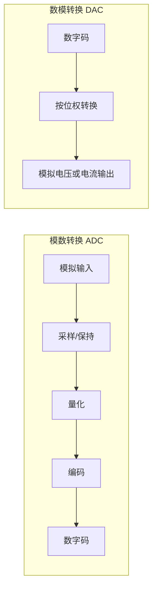

## 摘要

DAC 将数字码转换成模拟量，ADC 将模拟量转换成数字码。分辨率、误差和转换时间是相关但不同的指标，选型应匹配系统需求。

## 正文 / 要点

- DAC 常把数字码按位权转换成模拟电压或电流；有限位数字输入对应离散的输出等级。
- ADC 对输入模拟信号进行采样、量化和编码。采样保持电路可在转换期间维持输入近似不变。
- $n$ 位转换器有 $2^n$ 个编码等级。若按满量程跨度 FSR 定义理想量化步距，常用近似为 $\frac{\mathrm{FSR}}{2^n}$；端点定义和器件规格可能采用不同口径，应查数据手册。
- 记量化步距为 $\Delta\approx\mathrm{FSR}/2^n$ 时，理想舍入量化误差满足 $|e_{\mathrm{q}}|\le\Delta/2$；截断量化的误差范围不同。
- 分辨率描述可区分的最小等级，转换误差描述实际结果相对理想结果的偏差，转换时间描述输出达到规定精度所需时间。
- ADC 架构在速度、分辨率、功耗、抗干扰能力和成本上存在取舍；DAC 也需同时考虑输出形式、建立时间和误差。
- 采样定理讨论带限信号的采样频率条件；工程系统还要考虑抗混叠滤波、采样保持和量化误差。

若输入严格带限于最高频率 $f_{\max}$，通常要求采样率 $f_{\mathrm{s}}>2f_{\max}$，使频谱副本不重叠；$f_{\mathrm{s}}=2f_{\max}$ 是临界情况，需额外满足边界谱线可恢复等假设。实际系统会提高采样率并在 ADC 前加抗混叠滤波器。

### 转换链与量化示例

ADC 的三步各自解决不同问题：采样确定“何时测量”，量化把连续幅值归入有限等级，编码再把等级写成位串。DAC 的过程相反，但实际输出通常还需要重建滤波，不能把离散码直接理解成连续光滑波形。

以理想 3 位单极性 ADC 为例，假定输入范围为 [0,8 V)，并规定每个码对应宽度为 1 V 的区间。共有 2³=8 个码，步距 Δ=8/8=1 V。输入 3.4 V 落在 [3,4)，因此按区间编号得到码 011（十进制 3）。若按区间中点重建，代表电压为 3.5 V，误差为 -0.1 V。这是本例明确约定的量化方式；不同 ADC 的端点、编码偏移和舍入规则可能不同，实际应以传输曲线或数据手册为准。

从例子可看出，位数只决定可用等级数，不能单独说明绝对精度。偏移误差、增益误差、非线性、噪声和参考电压误差都可能使真实转换偏离理想量化结果。读规格时要把分辨率和总误差分开看。

### ADC 与 DAC 的转换链

### 关键指标对照

| 指标 | 含义 | 阅读规格时要确认 |
|---|---|---|
| 分辨率 | 可区分的数字等级数量或最小等级变化 | 位数、满量程跨度及步距定义 |
| 转换误差 | 实际结果相对理想传输关系的偏差 | 偏移、增益、非线性等误差口径 |
| 转换/建立时间 | 输出达到规定精度所需时间 | ADC 转换时间与 DAC 建立时间定义不同 |
| 采样条件 | ADC 对输入进行离散取样 | 采样率、带宽及抗混叠滤波条件 |

## 相关笔记

模数转换把连续时间/幅值信号变为离散样本和有限精度码字；采样与混叠的频域条件见傅里叶笔记，振荡电路笔记关联到产生和整形实际波形的电路。

- [[2026-11-05-脉冲整形与振荡电路]]
- [[2026-11-05-组合逻辑与时序逻辑]]

## 待办 / 延伸问题

- 用一款 ADC 和一款 DAC 的数据手册对照分辨率、满量程、误差和转换时间定义。
