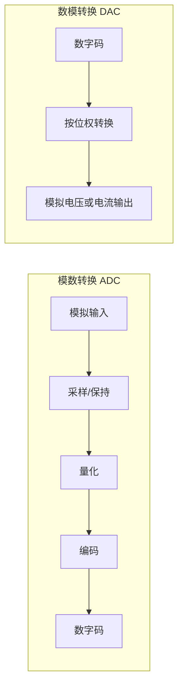

## 摘要

DAC 将数字码转换成模拟量，ADC 将模拟量转换成数字码。分辨率、误差和转换时间是相关但不同的指标，选型应匹配系统需求。

## 正文 / 要点

- DAC 常把数字码按位权转换成模拟电压或电流；有限位数字输入对应离散的输出等级。
- ADC 对输入模拟信号进行采样、量化和编码。采样保持电路可在转换期间维持输入近似不变。
- n 位转换器有 `2^n` 个编码等级。若按满量程跨度 FSR 定义理想量化步距，常用近似为 `FSR / 2^n`；端点定义和器件规格可能采用不同口径，应查数据手册。
- 分辨率描述可区分的最小等级，转换误差描述实际结果相对理想结果的偏差，转换时间描述输出达到规定精度所需时间。
- ADC 架构在速度、分辨率、功耗、抗干扰能力和成本上存在取舍；DAC 也需同时考虑输出形式、建立时间和误差。
- 采样定理讨论带限信号的采样频率条件；工程系统还要考虑抗混叠滤波、采样保持和量化误差。

### ADC 与 DAC 的转换链

### 关键指标对照

| 指标 | 含义 | 阅读规格时要确认 |
|---|---|---|
| 分辨率 | 可区分的数字等级数量或最小等级变化 | 位数、满量程跨度及步距定义 |
| 转换误差 | 实际结果相对理想传输关系的偏差 | 偏移、增益、非线性等误差口径 |
| 转换/建立时间 | 输出达到规定精度所需时间 | ADC 转换时间与 DAC 建立时间定义不同 |
| 采样条件 | ADC 对输入进行离散取样 | 采样率、带宽及抗混叠滤波条件 |

## 相关笔记

- [[2026-11-05-脉冲整形与振荡电路]]
- [[2026-11-05-组合逻辑与时序逻辑]]

## 待办 / 延伸问题

- 用一款 ADC 和一款 DAC 的数据手册对照分辨率、满量程、误差和转换时间定义。
