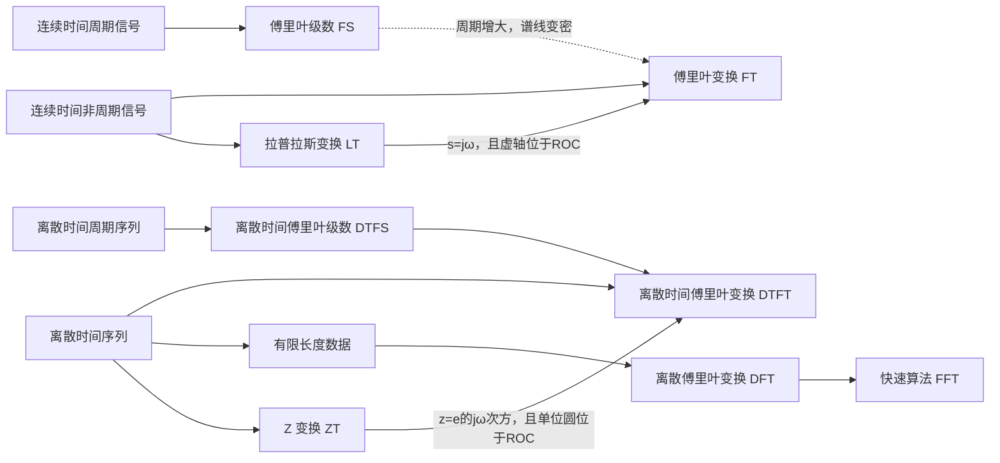

## 摘要

FS、FT、DTFT、DFT、FFT、拉普拉斯与 Z 变换围绕同一个问题展开：用适合信号时间结构和收敛条件的基函数描述信号。DFT 面向有限数据并在频率上取有限个点，FFT 是计算 DFT 的快速算法；拉普拉斯与 Z 变换则把分析扩展到复平面，并需同时看收敛域。

## 正文 / 要点

### 🗺️ 变换之间的路线

### 📚 各自处理什么

| 名称 | 主要输入 | 输出频域/变换域 | 要记住的关系 |
| --- | --- | --- | --- |
| FS（连续时间傅里叶级数） | 连续时间周期信号 | 基频整数倍上的离散系数 | 周期信号用谐波叠加；周期增大时谱线间隔缩小 |
| FT（连续时间傅里叶变换） | 连续时间非周期信号 | 连续角频率 $\omega$ | 周期信号在广义意义下呈现冲激谱线 |
| DTFS | 离散时间周期序列 | 一个周期内有限个独立系数 | 系数对频率索引周期重复，仅有 $N$ 个不同频点 |
| DTFT | 离散时间序列 | 连续但以 $2\pi$ 为周期的角频率函数 | $X(e^{j\omega})=\sum_nx[n]e^{-j\omega n}$ |
| DFT | 长度为 $N$ 的有限数据块 | $N$ 个离散频率系数 | 对应一个 $N$ 周期延拓；有限长度数据的频谱只在 $N$ 个频点取样 |
| FFT | DFT 输入数据 | 与 DFT 完全相同的系数 | 以更少运算量计算 DFT 的算法，不是另一种变换 |
| LT（拉普拉斯） | 连续时间信号/系统 | 复变数 $s=\sigma+j\omega$ | 傅里叶变换可视为在 $s=j\omega$ 虚轴上的取值，前提是虚轴位于 ROC |
| ZT（Z 变换） | 离散时间序列/系统 | 复变数 $z$ | 定义、收敛域与系统判据见 [[2026-11-05-Z变换与离散系统分析]]；DTFT 是单位圆上的取值，前提是单位圆位于 ROC |

### 🧮 DFT 與 FFT

常用的 $N$ 點 DFT 定義為

$$
X[k]=\sum_{n=0}^{N-1}x[n]e^{-j2\pi kn/N},\qquad k=0,1,\ldots,N-1,
$$

逆变换为

$$
x[n]=\frac{1}{N}\sum_{k=0}^{N-1}X[k]e^{j2\pi kn/N}.
$$

DFT 隐含地把一段有限数据视为一个周期的样本并作周期延拓，因此在卷积运算中自然出现的是循环卷积。FFT 以分治等结构减少计算量，输出仍然是上述 DFT 系数。若要以 DFT 近似线性卷积，需先补零到足够长度。

若 $x[n]$ 只在 $0\le n<N$ 非零，其 DTFT 为 $X(e^{j\omega})=\sum_{n=0}^{N-1}x[n]e^{-j\omega n}$，则 DFT 是在等间隔频率 $\omega_k=2\pi k/N$ 上对 DTFT 取样：

$$
X[k]=X(e^{j\omega})\big|_{\omega=2\pi k/N},\qquad k=0,1,\ldots,N-1.
$$

截取无限长信号等价于乘有限时窗，频域对应与窗谱卷积，所以离散频点之间的能量会扩散，形成谱泄漏。补零能让频率网格更密、便于读图，但不会增加原始观测信息或消除窗造成的泄漏。

### 🔗 LT、ZT 与傅里叶分析

双边变换的核分别为 $e^{-st}$ 与 $z^{-n}$。在 $s=j\omega$ 时，拉普拉斯核变成傅里叶核；在 $z=e^{j\omega}$ 时，Z 变换核变成 DTFT 核。这些等式只有在对应轴/圆落入收敛域时才能使用。采样周期为 $T_s$ 时，连续指数模态与离散指数模态常用 $z=e^{sT_s}$ 对应；这不代表 LT 与 ZT 在任意采样情况下可直接互换。

单边拉普拉斯和单边 Z 变换都适合把初始条件带入系统方程；双边形式更适合描述一般左右边序列并明确 ROC。两者的移位定义和边界初值项不同，解题时必须保持约定一致。

### 🧪 贯穿例：连续指数采样后怎样进入 DFT

从连续因果指数 $x(t)=e^{-at}u(t)$（$a>0$）开始。它的双边拉普拉斯变换为 $1/(s+a)$，ROC 是 $\operatorname{Re}(s)>-a$，包含虚轴，因此也有傅里叶变换 $X(j\omega)=1/(a+j\omega)$。这说明 LT 与 FT 的联系要由 ROC 保证。

以采样周期 $T_s$ 取样，令 $r=e^{-aT_s}$，得到离散序列 $x[n]=r^n u[n]$。它的 Z 变换为

$$
X(z)=\frac{1}{1-rz^{-1}},\qquad |z|>r.
$$

由于 $r<1$，单位圆位于 ROC 内；令 $z=e^{j\omega}$ 即得到 DTFT。连续极点 $s=-a$ 与离散极点 $z=e^{-aT_s}$ 的对应来自对指数模态采样：$e^{-at}|_{t=nT_s}=e^{-aT_sn}$，不是所有 LT 系统函数都可不加条件地直接代换。

若只保留前 $N$ 个样本，有限数据块的 DFT 则是

$$
X_N[k]=\sum_{n=0}^{N-1}r^ne^{-j2\pi kn/N}
=\frac{1-r^N}{1-re^{-j2\pi k/N}},\qquad k=0,\ldots,N-1.
$$

它是在 $N$ 个等间隔频率上采样该有限数据块的 DTFT，而不是无限序列频谱的完整替代。截断会引入窗效应；DFT 点数增加能让频率网格更密，但若没有增加观测时长，不会增加新观测信息。

## 相关笔记

- [[2026-11-05-傅里叶分析与采样]]
- [[2026-11-05-拉普拉斯变换与连续系统分析]]
- [[2026-11-05-信号分类与基本运算]]
- [[2026-11-05-信号与系统主题索引]]
- [[2026-11-05-离散序列与LTI系统基础]]
- [[2026-11-05-DFT与FFT计算方法]]
- [[2026-11-05-数字信号处理主题索引]]

阅读顺序可从 [[2026-11-05-傅里叶分析与采样]] 的连续频谱与采样开始，再读 [[2026-11-05-Z变换与离散系统分析]] 理解离散序列的 ROC，最后用 [[2026-11-05-DFT与FFT计算方法]] 学有限数据的计算实现。

## 待办 / 延伸问题

- 延伸阅读：[[2026-11-05-DFT与FFT计算方法]]、[[2026-11-05-数字信号处理主题索引]]，查看实际计算和滤波器设计。
- 用同一组 $N$ 个采样值分别绘制 DTFT 与 DFT 频点，观察 DFT 是 DTFT 的等间隔取样。
- 用长度不足的 DFT 直接计算两个有限序列的卷积，再比较补零后线性卷积与循环卷积的差异。
