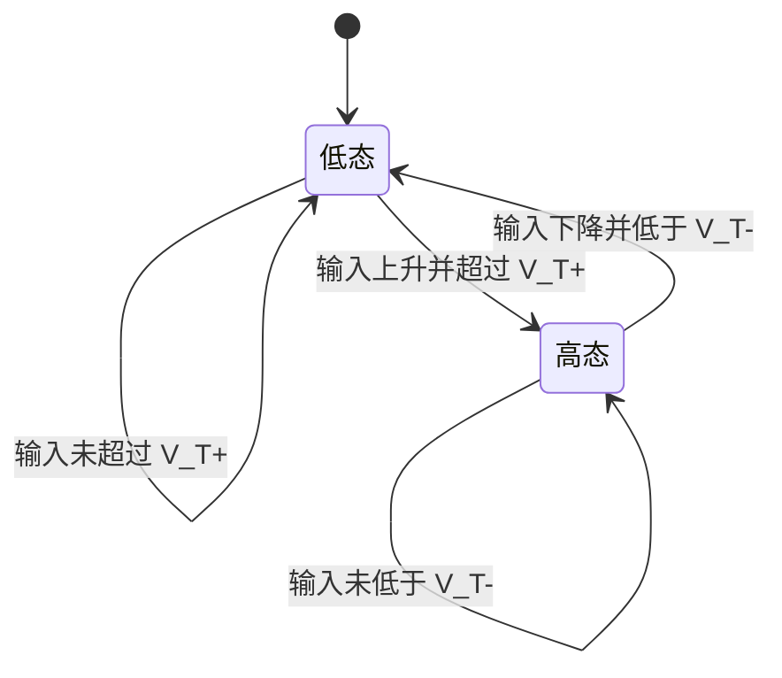

## 摘要

施密特触发器、单稳态电路和多谐振荡器分别常用于波形整形、定时/延时和自主产生周期脉冲。它们的稳态数量与触发方式不同。

## 正文 / 要点

- 施密特触发器具有滞回特性：输入上升和下降时的翻转阈值不同，可改善慢沿或带噪信号的逻辑整形。
- 设上升阈值为 $V_{\mathrm{T}+}$、下降阈值为 $V_{\mathrm{T}-}$，滞回宽度为 $\Delta V_{\mathrm{H}}=V_{\mathrm{T}+}-V_{\mathrm{T}-}>0$；具体阈值由拓扑和器件参数决定。
- 单稳态电路有一个稳定状态和一个暂稳态；受触发后暂时离开稳定状态，经过由电路参数决定的时间后返回。
- 多谐振荡器没有稳定状态，可在供电后自行往复变化并产生周期波形。
- 555 定时器可构成施密特触发、单稳态或多谐振荡电路；阈值、触发端和复位端的极性要按器件资料确认。
- 实际脉冲宽度、阈值和频率由拓扑、元件值和器件误差共同决定，不能只凭电路名称推断。

### 脉冲电路功能对照

| 电路 | 稳定状态 | 触发/运行方式 | 主要用途 |
|---|---:|---|---|
| 施密特触发器 | 两个稳定状态 | 输入跨越不同的上、下阈值时翻转 | 波形整形、抗慢沿和一定程度的噪声干扰 |
| 单稳态电路 | 一个稳定状态 | 触发后进入暂稳态，定时后返回 | 产生单次脉冲、定时或延时 |
| 多谐振荡器 | 无稳定状态 | 上电后自行周期变化 | 产生周期脉冲或方波 |

具体阈值、脉宽和频率取决于拓扑、器件与元件值，应以电路和数据手册为准。

### 施密特触发器：用滞回抑制阈值附近抖动

设某施密特触发器的上升阈值为 $V_{\mathrm{T}+}=2\,\mathrm{V}$、下降阈值为 $V_{\mathrm{T}-}=1\,\mathrm{V}$。输入从低往高升时，输出直到超过 $2\,\mathrm{V}$ 才翻转；输入随后下降时，输出要等到低于 $1\,\mathrm{V}$ 才翻回。$1$ 至 $2\,\mathrm{V}$ 的区间内，输出保持原状态，因此小噪声不会让输出在单一阈值附近反复跳变。

这是滞回机制的逻辑示意，不是特定电路的电压波形；实际阈值需由反馈电阻、供电和器件参数计算。滞回宽度 $\Delta V_{\mathrm{H}}=V_{\mathrm{T}+}-V_{\mathrm{T}-}$ 应大于预期噪声幅度，但也不能大到使有效信号无法跨越阈值。

### 单稳态与多谐振荡器的时间过程

单稳态电路只有一个稳定状态。触发信号到来后，电容等储能元件进入暂态充放电；当电压达到阈值，电路自动返回稳定态，因此输出脉宽由阈值和时间常数共同决定。多谐振荡器则让电容电压在上下阈值间反复变化，没有稳定状态，故无需重复外部触发就会持续产生脉冲。

| 观察问题 | 单稳态 | 多谐振荡器 |
|---|---|---|
| 上电后是否自行重复 | 否，等待触发 | 是，持续振荡 |
| 电容/定时网络作用 | 决定一次暂稳状态持续多久 | 决定阈值往返时间与周期 |
| 常见误判 | 把触发脉冲宽度当作输出脉宽 | 把器件阈值当作频率本身 |

具体的 $RC$ 脉宽或周期公式依电路拓扑和充放电路径而异，使用前应从该电路的电容电压方程推导，不能套用一个对所有拓扑通用的公式。

施密特触发器把模拟阈值变化转成稳定的逻辑状态，属于 [[2026-11-05-组合逻辑与时序逻辑]] 中的状态保持/触发问题；若需把传感器的模拟量送入数字电路，还可对照 [[2026-11-05-数模与模数转换]]。

## 相关笔记

- [[2026-11-05-组合逻辑与时序逻辑]]
- [[2026-11-05-数模与模数转换]]

## 待办 / 延伸问题

- 用 555 数据手册分别推导单稳态脉宽和无稳态振荡周期。
