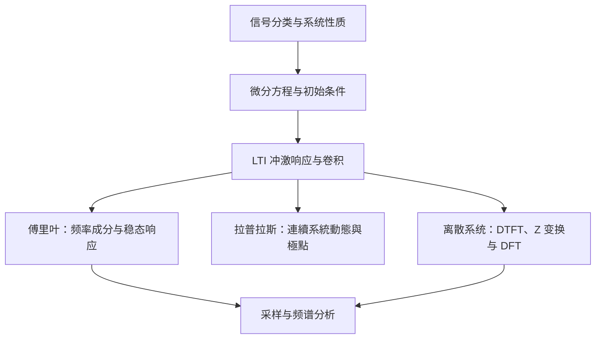

## 摘要

本索引连接信号描述、系统时域响应、频域分析和复频域分析。先从信号类型与系统性质入手，再用 LTI 卷积描述零状态响应，按问题选择傅里叶、拉普拉斯或离散变换。

## 正文 / 要点

本主题研究“输入信号经过系统后会发生什么”。先学会描述信号，再用系统性质判断分析方法；对线性时不变系统，冲激响应和卷积给出时域答案。傅里叶方法把同一问题拆成频率成分，拉普拉斯与 Z 变换则通过复变量和收敛域扩展可分析的系统范围。离散信号的有限段计算再由 DFT/FFT 承接。

### 🧭 学习路径

### 各阶段如何衔接

先看 [[2026-11-05-信号分类与基本运算]]，因为偶奇性、周期、移位和缩放会影响后续的变换与卷积；随后学 [[2026-11-05-线性时不变系统与卷积]]，掌握如何由冲激响应求零状态输出。接下来按问题选择工具：周期信号的谐波组成和正弦稳态看 [[2026-11-05-傅里叶分析与采样]]；连续系统微分方程、瞬态和初始条件看 [[2026-11-05-拉普拉斯变换与连续系统分析]]；离散系统差分方程、因果性与稳定性看 [[2026-11-05-Z变换与离散系统分析]]。

[[2026-11-05-离散傅里叶变换与FFT、拉普拉斯和Z变换的关系]] 用一张图定位 FS、FT、DTFT、DFT/FFT、LT 与 ZT：它适合用来辨清输入对象、频率变量、频谱形态和收敛条件，但不能代替各变换的定义与计算。采样把连续信号变为离散序列；采样率不足会造成频谱副本重叠，因此在用 DFT 分析数据前还要理解抗混叠条件。

遇到题目时可先问三件事：信号是连续还是离散、周期还是非周期；题目要回答时域响应还是频率组成；初始条件和收敛域是否影响结论。这样能先选对工具，再检查相应的定义条件。

### 📚 提炼笔记

| 主题      | 核心问题                           | 笔记                                     |
| ------- | ------------------------------ | -------------------------------------- |
| 信号分类与运算 | 信号属于哪些时间/能量类别？如何变换时间轴？         | [[2026-11-05-信号分类与基本运算]]               |
| LTI 与卷积 | 怎样从冲激响应求零状态输出？                 | [[2026-11-05-线性时不变系统与卷积]]              |
| 傅里叶与采样  | 周期、非周期信号的频谱如何表示？怎样避免混叠？        | [[2026-11-05-傅里叶分析与采样]]                |
| 拉普拉斯分析  | 如何求解连续系统方程并判断极点与稳定性？           | [[2026-11-05-拉普拉斯变换与连续系统分析]]           |
| Z 变换分析 | 如何处理离散系统差分方程、ROC 与稳定性？ | [[2026-11-05-Z变换与离散系统分析]] |
| 变换关系    | FS、FT、DTFT、DFT、FFT、LT、ZT 如何衔接？ | [[2026-11-05-离散傅里叶变换与FFT、拉普拉斯和Z变换的关系]] |
| DSP 延伸  | 离散系统滤波器结构、设计与计算                | [[2026-11-05-数字信号处理主题索引]]              |

### 🗂️ 原始资料

| 类型 | 原始资料 |
| --- | --- |
| 视频：基础概念 | [[2026-11-05-《信号与系统》第1章精讲：为什么这些基础概念如此重要？｜郑君里第四版]] |
| 视频：卷积与时域分析 | [[2026-11-05-《信号与系统》第2章：卷积为什么会出现？从微分方程到系统响应｜郑君里第四版]] |
| 视频：课程全景图 | [[2026-11-05-一张图看懂〈信号与系统〉：卷积、傅里叶、拉普拉斯到底在研究什么？]] |
| 视频：变换关系 | [[2026-11-05-解释傅里叶级数(FS)、傅里叶变换(FT)、 离散时间傅里叶变换(DTFT)、离散傅里叶变换(DFT 和 FFT)、拉普拉斯变换(LT)和Z变换(ZT)的关系]] |
| 复习笔记 | [[2026-11-05-《信号与系统》复习笔记]]、[[2026-11-05-信号与系统期末复习知识点]] |
| 课程笔记 | [[2026-11-05-《信号与系统》学习笔记]]、[[2026-11-05-【学习笔记】信号与系统知识点总结（持续更新）]]、[[2026-11-05-信号与系统知识点总结 凌川的小站]] |

## 相关笔记

- [[2026-11-05-信号分类与基本运算]]
- [[2026-11-05-线性时不变系统与卷积]]
- [[2026-11-05-傅里叶分析与采样]]
- [[2026-11-05-拉普拉斯变换与连续系统分析]]
- [[2026-11-05-Z变换与离散系统分析]]
- [[2026-11-05-离散傅里叶变换与FFT、拉普拉斯和Z变换的关系]]

## 待办 / 延伸问题

- DSP 原理与实现见 [[2026-11-05-数字信号处理主题索引]]；本组不重复展开 Z 域滤波器设计、IIR/FIR 实现。
- 可补充一组从微分方程、冲激响应、频率响应到系统函数的同一系统例题。
