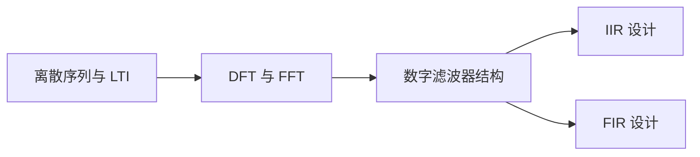

## 摘要

本页汇总离散时间信号基础、DFT/FFT、数字滤波器实现与 IIR/FIR 设计，并链接本轮处理的 10 篇原始资料。连续/离散变换的完整关系见 [[2026-11-05-信号与系统主题索引]]。

## 正文 / 要点

### 从问题出发

数字信号处理中常见的路线是：先在时域描述序列和系统，再转到频域观察不同频率成分，最后把理论关系变成可实现的算法与滤波器。[[2026-11-05-离散序列与LTI系统基础]]回答“离散系统如何运算与响应”；DFT/FFT 笔记回答“有限数据怎样得到频谱”；滤波器笔记则把频率选择目标转成结构、系数和稳定性约束。

### 提炼笔记导航

| 主题 | 笔记 | 适合解决的问题 |
| --- | --- | --- |
| 时域基础 | [[2026-11-05-离散序列与LTI系统基础]] | 序列运算、周期、系统性质、卷积和差分方程 |
| 频谱计算 | [[2026-11-05-DFT与FFT计算方法]] | DFT 索引、FFT 算法、频谱分析和快速卷积 |
| 算法实现 | [[2026-11-05-离散滤波器结构与实现]] | 直接型、级联型、并联型及有限字长检查 |
| 递归滤波 | [[2026-11-05-无限冲激响应滤波器设计]] | 模拟原型、数字化方法、预畸变和稳定性 |
| 非递归滤波 | [[2026-11-05-有限冲激响应滤波器设计]] | 线性相位、窗函数、频率抽样与方法比较 |

### 原始资料导航

#### 分章讲义

- [[2026-11-05-数字信号处理1]]：时域离散信号与系统。
- [[2026-11-05-数字信号处理2]]：离散系统频域分析。
- [[2026-11-05-数字信号处理3]]：离散傅里叶变换。
- [[2026-11-05-数字信号处理4]]：快速傅里叶变换。
- [[2026-11-05-数字信号处理5]]：离散系统网络结构。
- [[2026-11-05-数字信号处理6]]：IIR 滤波器设计。
- [[2026-11-05-数字信号处理7]]：FIR 滤波器设计。

#### 复习与补充

- [[2026-11-05-数字信号处理—重点内容梳理_数字信号处理知识点总结-CSDN博客]]：DSP 框架、频谱分析与滤波器设计总结。
- [[2026-11-05-数字信号处理期末复习(个人笔记)]]：课程复习提纲及图示。
- [[2026-11-05-数字信号处理：重要知识点整理_数字信号处理知识点总结]]：MATLAB 计算提示、频谱分析与设计方法摘要。

### 学习路径

阅读时先熟悉序列、卷积和差分方程，再学 DFT 频率索引与 FFT 的计算意义；之后看滤波器结构，理解同一系统函数如何映射到不同运算网络。最后分别学习 IIR 和 FIR：IIR 通常以较低阶数实现较陡的幅频响应，但有反馈并须严格检查稳定性；FIR 无反馈且可设计为线性相位，但达到相同指标时可能需要更多抽头。实际选择取决于相位、阶数、延迟和数值实现要求。

### 概念之间的桥接

- [[2026-11-05-离散傅里叶变换与FFT、拉普拉斯和Z变换的关系]]：从连续/离散、无限/有限及复频域几个角度定位变换，适合在学习 DFT 前后查阅。
- [[2026-11-05-Z变换与离散系统分析]]：提供差分方程到系统函数、ROC、因果性和稳定性的理论依据，是 IIR 设计的先修内容。
- [[2026-11-05-离散滤波器结构与实现]]：把传递函数变成延迟器、乘法器和加法器组成的计算结构，是理论到实现的桥梁。

## 相关笔记

- [[2026-11-05-信号与系统主题索引]]：提供连续信号、采样、傅里叶与系统分析的基础。
- [[2026-11-05-数字电子技术主题索引]]：关注数字逻辑硬件、状态和数据表示；DSP 关注离散信号算法与数值实现。
- [[2026-11-05-模拟电子技术主题索引]]：模拟滤波器可作为 IIR 数字化设计的原型背景。

## 待办 / 延伸问题

- 后续补充实际规格下的 IIR 与 FIR 设计算例，并链接到「05 我的产出」中的实验记录。
